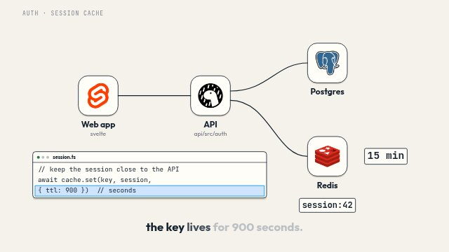
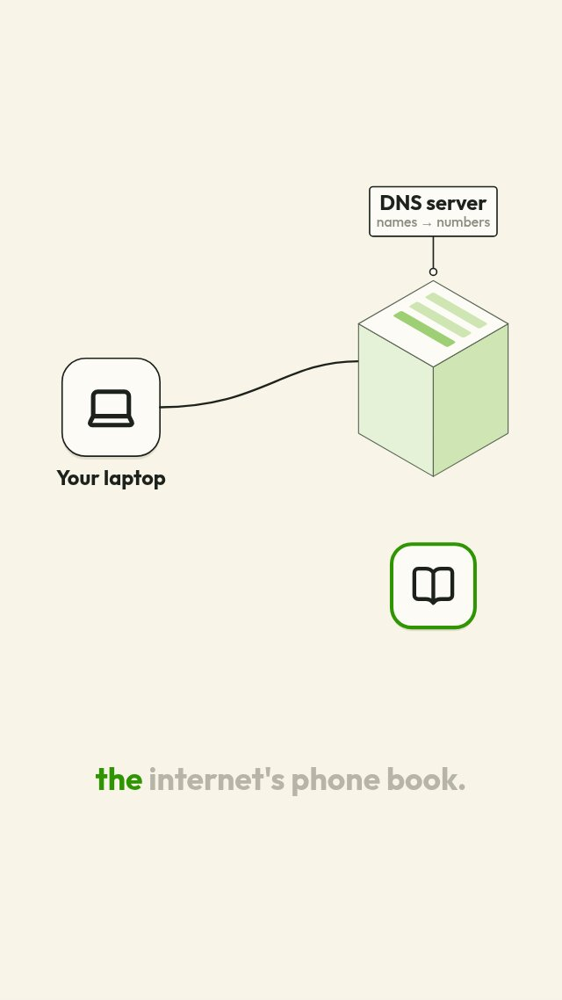

# TSVG: Timeseries Scalable Vector Graphics

**A video format that is a document, not pixels.** A `.tsvg` file is XML: vector shapes, text, images and sound on a timeline, plus the options a viewer may choose. An engine draws every frame live, so the same small file:

- stays **sharp at any zoom** and any screen density,
- plays in **several languages, audio mixes, themes and layouts** (portrait/landscape). The demo is 24 videos in one 13 KB document,
- has **real video controls**: timeline with chapters, ±10 s, speed, captions, scrub previews,
- contains **no HTML and no JavaScript**, so native engines (web, Flutter, …) can play it safely,
- is **cheap to make and to change**. It is easy for people and AI agents to write, and editing a line changes the video. No re-encoding.

```xml
<tsvg version="0.1" title="@title">
  <layouts><layout id="landscape" w="1920" h="1080"/><layout id="portrait" w="1080" h="1920"/></layouts>
  <options><option id="lang" default="en"><choice id="en"/><choice id="gu" label="ગુજરાતી"/></option></options>
  <themes><theme id="dark" bg="#0e1117" fg="#eef1f7" accent="#7aa2ff"/></themes>
  <strings><s id="title" en="Hello" gu="નમસ્તે"/><s id="vo1" en="Hello, world." gu="નમસ્તે, દુનિયા."/></strings>
  <timeline>
    <scene id="intro" dur="5" chapter="@title">
      <say at="0.5" text="@vo1"/>
      <text x="=W/2" y="=H/2" size="160" size.portrait="120" weight="800" align="center" text="@title" fill="$accent">
        <anim prop="opacity" from="0" to="1" dur="0.8"/>
      </text>
    </scene>
  </timeline>
</tsvg>
```

## What's here

| Path | What |
| --- | --- |
| [`spec/index.html`](spec/index.html) | The specification (TSVG 0.1 draft) |
| [`web/`](web) | Reference engine: `tsvg-core.js` (parser, expression language, renderer, validator), `tsvg-player.js` (player with controls and an audio mixer), `tsvg-zip.js` (`.tsvgz` packages). No dependencies. |
| [`cli/tsvg.mjs`](cli/tsvg.mjs) | `validate`, `info`, `pack`, `unpack`, `bake` (TTS per language), `render` (PNG), `export` (MP4), `test` (golden frames), `serve` |
| [`flutter/`](flutter) | Flutter engine and player widget |
| [`playground/`](playground) | Edit a TSVG and watch it play |
| [`editor/`](editor) | Visual editor (`tsvg edit`) and live preview (`tsvg watch`) pages |
| [`examples/demo/`](examples/demo) | The demo: 6 scenes, en + gu voices, gradients, masks, clip, shadow, fonts, a photo |
| [`libs/`](libs) | Built-in libraries: `base`, `report`, `explainer`, `charts`, `icons`, `fx` (components + styles) |
| [`skills/`](skills) | Agent skills: [`tsvg`](skills/tsvg/SKILL.md) (asks which style, then writes, checks and ships a TSVG video), [`tech-explainer`](skills/tech-explainer/SKILL.md) (why / how tech explainers, any format), [`codebase-explainer`](skills/codebase-explainer/SKILL.md) (how a feature in your code works, for the dev team) |
| [`.claude-plugin/`](.claude-plugin) | Claude Code plugin + marketplace manifests: install the skill and CLI with `/plugin` ([below](#claude-code-plugin)) |
| [`tests/`](tests) | Conformance cases and golden frames |

## For agents (and people in a hurry)

```sh
tsvg new my-report                 # report template on the tsvg:report library: edit the props of 5 lines
tsvg check my-report/my-report.tsvg  # compiler: errors with line numbers + "did you mean", off-frame / overlapping text
tsvg make  my-report/my-report.tsvg  # check → bake voices → contact sheets (one PNG per layout) → my-report.tsvgz
tsvg lib report                    # the components of a library, one line each
tsvg styles                        # 62 style templates; tsvg new <dir> --style <id>
```
No rendering or encoding: `make` takes seconds. The agent skill is in [`skills/tsvg/SKILL.md`](skills/tsvg/SKILL.md).

### Claude Code plugin

This repo is a Claude Code plugin marketplace. Install the skills and the CLI in one step:

```
/plugin install tsvg --marketplace Panth977/tsvg
```
(older Claude Code: `/plugin marketplace add Panth977/tsvg`, then `/plugin install tsvg@tsvg`). Then ask Claude for a video, e.g. "make a TSVG explaining our login flow". The first `check`/`make` runs `npm install` inside the plugin (playwright-core, uses your installed Chrome; set `TSVG_CHROME` for Chromium/Brave). Narration needs `ffmpeg` + Kokoro; without it, `make --no-bake` ships captions only.

## Libraries: write the content, import the look

A library (`.tsvgl`) packages **components with props**, **styles** (themes, fonts, symbols, gradients, music, backdrop) and document defaults. A document imports it and writes only content: same props, same video, every time, in about a tenth of the markup.

```xml
<tsvg version="0.3" title="ORCH-78">
  <import src="tsvg:report" as="r" key="ORCH-78"/>
  <timeline>
    <r:title title="Video libraries are live" sub="Import a style, write only the content" say="Phase one is done."/>
    <r:list title="What changed" items="Import :: one line | Components :: tags with props | Two libraries" say="Three things changed."/>
    <r:shot src="images/screen.png" box="0.08 0.1 0.42 0.4" caption="The import line" say="This is where to look."/>
    <r:stat value="90" suffix="%" label="fewer lines to write" say="Agents write ninety percent less."/>
  </timeline>
</tsvg>
```

| Library | Components | Demo |
| --- | --- | --- |
| `tsvg:report` | `title` `list` (change / check / open / step / no) `shot` `stat` `compare` `code` | [▶ report](https://panth977.github.io/tsvg/playground/?doc=../examples/libs/report.tsvg) |
| `tsvg:explainer` | `title` `point` `chapter` `steps` `stat` `quote` `picture` `versus` `outro` | [▶ explainer](https://panth977.github.io/tsvg/playground/?doc=../examples/libs/explainer.tsvg) |
| `tsvg:tech` | tech explainers in 16:9, 9:16 and 1:1 from one document: `beat` (scene + word-by-word caption; tall or wide stage) `follow` `tile` `label` `pill` `wire` `packet` `box` (isometric) `room` `window` `phone` `doc` `code` `tokens` `chip` `shot` (real UI + ring) `stat` `headline` `sum` `qs`; themes paper (green) · oizom · oizom-dark; skills `tech-explainer`, `codebase-explainer` | [▶ tech explainer](https://panth977.github.io/tsvg/playground/?doc=../examples/styles/tech-explainer.tsvg) · [▶ codebase](https://panth977.github.io/tsvg/playground/?doc=../examples/styles/codebase-explainer.tsvg) |
| `tsvg:fx` | overlays `grain` `vignette` `scanlines` `leak` `flash`; wrappers `grade` (looks) `glow` `shake` `beat` | [▶ effects + beats](https://panth977.github.io/tsvg/playground/?doc=../examples/fx/fx.tsvg) |
| `tsvg:charts` | `bars` `hbars` `line` `pie` (donut) `ring` `counter` `spark`: one tag with a list of numbers | [▶ charts + icons](https://panth977.github.io/tsvg/playground/?doc=../examples/charts/charts.tsvg) |
| `tsvg:icons` | `icon`: 2,104 [Lucide](https://lucide.dev/icons) line icons (ISC), `<i:icon name="rocket" size="64" color="$accent" drawin="0.8"/>`; `tsvg icons rock` finds names | same |
| `tsvg:base` | `num` `heading` `pill` + themes, fonts, music, symbols (`b:tick` `b:dot` `b:cross` `b:arrow`) | used by all |

- Make your own: a `<tsvglib name="…">` file with `<component id props>` bodies (`%{prop}`, `<if>`, `<each>`, `<slot/>`), publish it anywhere (`jsr:@you/pkg@1.0.0/my.tsvgl`, a URL, a relative path). Spec: [§13 Libraries](https://panth977.github.io/tsvg/spec/#libs).
- Override the look from the document: `<themes><theme id="dark" accent="#e4572e"/></themes>` changes one token; your own `<layouts>` or `<option id="lang">` replace the library's.
- Packages are flattened: `main.tsvg` is plain TSVG (any player plays it), `source.tsvg` keeps your imports, library files ride along under `lib/`.

## Layout and timing without numbers (0.5)

```xml
<scene dur="auto">                                   <!-- as long as its narration, in every language -->
  <say id="a" text="Cards size themselves."/> <say id="b" text="And appear with the voice."/>
  <row x="=W/2" y="=H/2" ax="0.5" ay="0.5" gap="40">  <!-- row / col / grid place their children -->
    <col pad="40" gap="16" fill="$panel" r="24" at="=cue('a')"><text size="30" text="Short"/><text size="56" text="42"/></col>
    <col pad="40" gap="16" fill="$panel" r="24" at="=cue('b')"><text size="28" maxw="360" text="Text wraps and the card grows."/></col>
  </row>
</scene>
```
[▶ layout + timing demo](https://panth977.github.io/tsvg/playground/?doc=../examples/layout/layout.tsvg) · spec [§3.6](https://panth977.github.io/tsvg/spec/#timeline), [§5](https://panth977.github.io/tsvg/spec/#nodes)

## Rich text, word-by-word, transitions (0.6)

```xml
<timeline in="fade 0.5">                                                  <!-- every scene fades in -->
  <scene dur="auto" in="push 0.6 left">                                   <!-- fade slide push wipe zoom iris blur -->
    <text rich="1" text="Mix **bold**, *italic*, [colour]($accent), ==highlights== and `code`"/>
    <text split="word" stagger="0.12" text="Every word arrives"><anim prop="y" from="60" to="0" dur="0.5"/></text>
    <text ls="14" text="LETTER SPACING"/>
    <text path="M 0 100 C 350 -260 1050 460 1400 60" offset="=0.2*T" text="text on a curve"/>
  </scene>
</timeline>
```
[▶ rich text + transitions demo](https://panth977.github.io/tsvg/playground/?doc=../examples/text/text.tsvg)

## Video clips (0.8)

```xml
<assets><asset id="clip" src="clips/fractal.mp4"/></assets>
<scene dur="auto">
  <video src="clip" x="=W/2" y="=H/2" ax="0.5" ay="0.5" w="=W" h="=H" fit="cover"/>     <!-- full-bleed footage -->
  <video src="clip" w="640" h="360" r="24" start="2" rate="0.5" rot="-3"/>              <!-- trimmed, slowed, rounded -->
  <text text="Graphics on top" .../>
</scene>
```
Clips seek with the timeline, play at the player's speed, sit in layouts, take masks and transforms, and export frame-exact. `tsvg pack` adds a poster frame. [▶ video demo](https://panth977.github.io/tsvg/playground/?doc=../examples/video/video.tsvg)

## Effects, grades, beats (0.9)

```xml
<import src="tsvg:fx" as="fx"/>
<music src="beat" loop="1" beats="beats"/>            <!-- tsvg make bakes the beat grid into <data id="beats"> -->
<mix id="full" voice="1" music="0.5" duck="0.3"/>     <!-- music dips under every spoken line -->
<image src="photo" filter="grayscale({1 - clamp(T/3, 0, 1)}) contrast(1.1)"/>   <!-- any node: CSS-style filters -->
<fx:grade look="vintage"><video src="clip"/></fx:grade>   <!-- mono noir warm cool vintage punch faded -->
<fx:beat beats="beats" x="=W/2" y="=H/2"><circle r="160"/></fx:beat>   <circle r="=10 + 24*pulse(t, 'beats', 0.2)"/>
<rect skx="-12"/>  <fx:grain/> <fx:vignette/> <fx:leak/> <fx:scanlines/> <fx:flash at="2"/> <fx:glow>…</fx:glow> <fx:shake at="1">…</fx:shake>
```
[▶ effects + beats demo](https://panth977.github.io/tsvg/playground/?doc=../examples/fx/fx.tsvg)

## Tools: live preview, visual editor, captions, small packages (0.10)

```sh
tsvg watch my.tsvg       # live preview: reloads on every save, keeps the position, shows errors with line numbers
tsvg edit  my.tsvg       # visual editor: click to select, drag to move, edit attributes / component props / strings, save
tsvg captions my.tsvg --lang gu -o gu.vtt      # WebVTT (or --srt) of the narration
tsvg pack  my.tsvg       # packages carry captions/<lang>.vtt; fonts are subset, big pictures become WebP (--full: as is)
```
The editor also opens read-only on the web: [▶ editor with the report demo](https://panth977.github.io/tsvg/editor/?doc=../examples/libs/report.tsvg). The player has a Chapters menu. Full list: [CHANGELOG](CHANGELOG.md).

## Quick start

```sh
npm install                                   # playwright-core, for render/export/test (uses your installed Chrome)
node cli/tsvg.mjs serve .                     # http://127.0.0.1:4380/playground/ and /spec/
node cli/tsvg.mjs validate examples/demo/demo.tsvg
node cli/tsvg.mjs render examples/demo/demo.tsvg -t 30 --lang gu --layout portrait -o frame.png
node cli/tsvg.mjs pack examples/demo/demo.tsvg -o demo.tsvgz                 # the .tsvgz carries index.html: unzip, open it, it plays
node cli/tsvg.mjs pack examples/demo/demo.tsvg --html demo.html          # one offline page, plays in any browser
node cli/tsvg.mjs export examples/demo/demo.tsvg --lang gu --layout portrait --captions -o demo.mp4
npm test
```

Install or load from a CDN ([JSR: @panth977/tsvg](https://jsr.io/@panth977/tsvg)):

```ts
import { TSVGPlayer, TSVG, TSVGZip } from "jsr:@panth977/tsvg";            // Deno / bundlers (npx jsr add @panth977/tsvg)
import { TSVGPlayer } from "https://esm.sh/jsr/@panth977/tsvg@0.10.0";     // any browser, no build
```
```html
<script src="https://esm.sh/jsr/@panth977/tsvg@0.10.0/dist/tsvg.js?raw"></script>  <!-- classic script: window.TSVG, TSVGZip, TSVGPlayer -->
<!-- or from npm (jsdelivr; works inside claude.ai artifacts, + tsvg-libs.js bundles the built-in libraries):
     <script src="https://cdn.jsdelivr.net/npm/@dixitram/tsvg@0.10.1/tsvg.js"></script>
     <script src="https://cdn.jsdelivr.net/npm/@dixitram/tsvg@0.10.1/tsvg-libs.js"></script>
     <script type="text/tsvg" data-play><tsvg …>…</tsvg></script>   (plays in place) -->
```

Embed the player:

```html
<script src="web/tsvg-core.js"></script><script src="web/tsvg-zip.js"></script><script src="web/tsvg-player.js"></script>
<div id="v" style="width:960px;aspect-ratio:16/9"></div>
<script>new TSVGPlayer(document.getElementById('v')).open('demo.tsvgz');</script>
```

## Style gallery

<!-- styles:start -->
**62 styles**, each a ~1-minute TSVG video with narration. ▶ [Open the gallery](https://panth977.github.io/tsvg/gallery/) to play any of them in the browser (click a thumbnail).

#### Product & software

<table><tr>
<td width="25%" valign="top"><a href="https://panth977.github.io/tsvg/gallery/#product-screenshot-tour"></a><br><b>Product screenshot tour</b><br><sub>Real screenshots in a browser frame: camera zooms into regions, a spotlight dims the rest, highlight boxes and callout pills with arrows. · 59 s · <a href="examples/styles/product-screenshot-tour.tsvg">source</a></sub></td>
<td width="25%" valign="top"><a href="https://panth977.github.io/tsvg/gallery/#screencast-cursor"></a><br><b>Screencast tutorial</b><br><sub>Screen-recording look: a vector cursor glides and clicks with ripples, typed input, a dropdown, drag and drop, REC badge and step captions. · 61 s · <a href="examples/styles/screencast-cursor.tsvg">source</a></sub></td>
<td width="25%" valign="top"><a href="https://panth977.github.io/tsvg/gallery/#feature-onboarding"></a><br><b>App onboarding carousel</b><br><sub>Onboarding pages: big friendly illustrations, a title and one line, stretching page dots, Skip/Next and swipe transitions. · 55 s · <a href="examples/styles/feature-onboarding.tsvg">source</a></sub></td>
<td width="25%" valign="top"><a href="https://panth977.github.io/tsvg/gallery/#release-notes"></a><br><b>Release notes</b><br><sub>What's new in v0.2: a version badge, a changelog with NEW/IMPROVED/FIXED chips, a live demo per entry and a before/after wipe. · 57 s · <a href="examples/styles/release-notes.tsvg">source</a></sub></td>
</tr><tr>
<td width="25%" valign="top"><a href="https://panth977.github.io/tsvg/gallery/#qa-bug-walkthrough"></a><br><b>QA bug walkthrough</b><br><sub>A bug report as a video: ticket header, environment chips, repro steps beside a phone, expected vs actual, root cause and verdict stamps. · 66 s · <a href="examples/styles/qa-bug-walkthrough.tsvg">source</a></sub></td>
<td width="25%" valign="top"><a href="https://panth977.github.io/tsvg/gallery/#mobile-app-walkthrough"></a><br><b>Mobile app walkthrough</b><br><sub>A vector phone holds a real screenshot and vector screens: taps with ripples, slides, a bottom sheet and a turn to landscape. · 56 s · <a href="examples/styles/mobile-app-walkthrough.tsvg">source</a></sub></td>
<td width="25%" valign="top"><a href="https://panth977.github.io/tsvg/gallery/#dashboard-kpi-tour"></a><br><b>Dashboard KPI tour</b><br><sub>Analytics dashboard: KPI cards count up, sparklines and a 30-day line draw, bars grow, and a spotlight focuses one panel at a time. · 58 s · <a href="examples/styles/dashboard-kpi-tour.tsvg">source</a></sub></td>
<td width="25%" valign="top"><a href="https://panth977.github.io/tsvg/gallery/#code-walkthrough"></a><br><b>Code walkthrough</b><br><sub>An editor in JetBrains Mono with token colours, a moving line highlight, annotations beside lines and a unified diff that pushes lines down. · 62 s · <a href="examples/styles/code-walkthrough.tsvg">source</a></sub></td>
</tr><tr>
<td width="25%" valign="top"><a href="https://panth977.github.io/tsvg/gallery/#codebase-explainer"></a><br><b>Codebase explainer</b><br><sub>How a feature really works, for the dev team: real logos, one blue focus at a time, a packet riding the flow, the code that proves it, the rows it writes, and an honest In short + checked / open ending. Oizom paper or editor-dark; tsvg:tech. · 37 s · <a href="examples/styles/codebase-explainer.tsvg">source</a></sub></td>
<td width="25%" valign="top"><a href="https://panth977.github.io/tsvg/gallery/#terminal-cli-demo"></a><br><b>Terminal CLI demo</b><br><sub>Terminal recording: typed commands with a block cursor, output lines, progress bars and a success tick; modern or retro green CRT theme. · 63 s · <a href="examples/styles/terminal-cli-demo.tsvg">source</a></sub></td>
<td width="25%" valign="top"><a href="https://panth977.github.io/tsvg/gallery/#architecture-diagram"></a><br><b>Architecture diagram</b><br><sub>Blueprint system diagram: services pop in, arrows draw on, packets flow along curves, and the camera zooms into one service to open it up. · 62 s · <a href="examples/styles/architecture-diagram.tsvg">source</a></sub></td>
</tr></table>

#### Education & science

<table><tr>
<td width="25%" valign="top"><a href="https://panth977.github.io/tsvg/gallery/#math-animation-dark"></a><br><b>Dark maths animation</b><br><sub>Axes draw on, a sine curve traces, a tangent slides and the slope becomes cosine; coloured equation terms and path morphs. · 57 s · <a href="examples/styles/math-animation-dark.tsvg">source</a></sub></td>
<td width="25%" valign="top"><a href="https://panth977.github.io/tsvg/gallery/#whiteboard-drawing"></a><br><b>Whiteboard drawing</b><br><sub>Marker doodles draw stroke by stroke with handwritten notes: how habits stick, from cue to routine to reward. · 66 s · <a href="examples/styles/whiteboard-drawing.tsvg">source</a></sub></td>
<td width="25%" valign="top"><a href="https://panth977.github.io/tsvg/gallery/#chalkboard-lesson"></a><br><b>Chalkboard lesson</b><br><sub>Green board, dusty chalk handwriting, pie diagrams, underlines and a circled answer: adding fractions step by step. · 69 s · <a href="examples/styles/chalkboard-lesson.tsvg">source</a></sub></td>
<td width="25%" valign="top"><a href="https://panth977.github.io/tsvg/gallery/#science-diagram"></a><br><b>Labelled science diagram</b><br><sub>The water cycle built up part by part: numbered callouts with leader lines, flow arrows, rain and rivers in motion. · 62 s · <a href="examples/styles/science-diagram.tsvg">source</a></sub></td>
</tr><tr>
<td width="25%" valign="top"><a href="https://panth977.github.io/tsvg/gallery/#physics-simulation"></a><br><b>Physics simulation</b><br><sub>Live motion from equations: a projectile with trace and vectors, a launch-angle sweep, pendulums with energy bars. · 66 s · <a href="examples/styles/physics-simulation.tsvg">source</a></sub></td>
<td width="25%" valign="top"><a href="https://panth977.github.io/tsvg/gallery/#probability-visual"></a><br><b>Probability visual</b><br><sub>Coin grid with a live heads counter, dice combinations and histograms that grow from flat into a bell curve. · 66 s · <a href="examples/styles/probability-visual.tsvg">source</a></sub></td>
<td width="25%" valign="top"><a href="https://panth977.github.io/tsvg/gallery/#quiz-countdown"></a><br><b>Quiz countdown</b><br><sub>Game-show quiz: question card, four answers, a countdown ring, a pop reveal with confetti and a running score. · 67 s · <a href="examples/styles/quiz-countdown.tsvg">source</a></sub></td>
<td width="25%" valign="top"><a href="https://panth977.github.io/tsvg/gallery/#flashcards-bilingual"></a><br><b>Bilingual flashcards (EN → GU)</b><br><sub>English → Gujarati flashcards that flip to word, pronunciation and an example sentence; English or Gujarati captions. · 68 s · <a href="examples/styles/flashcards-bilingual.tsvg">source</a></sub></td>
</tr><tr>
<td width="25%" valign="top"><a href="https://panth977.github.io/tsvg/gallery/#step-by-step-howto"></a><br><b>Step-by-step how-to</b><br><sub>Six numbered steps on a progress rail: terminal and browser illustrations, checklist ticks, light and dark themes. · 66 s · <a href="examples/styles/step-by-step-howto.tsvg">source</a></sub></td>
<td width="25%" valign="top"><a href="https://panth977.github.io/tsvg/gallery/#mind-map"></a><br><b>Mind map</b><br><sub>A trip plan as a mind map: coloured branches grow from a central topic while the camera travels branch to branch. · 62 s · <a href="examples/styles/mind-map.tsvg">source</a></sub></td>
</tr></table>

#### News & data

<table><tr>
<td width="25%" valign="top"><a href="https://panth977.github.io/tsvg/gallery/#collage-newsroom"></a><br><b>Collage newsroom</b><br><sub>Paper-texture collage: cut-out photos with tape, torn clippings, a highlighter over wire copy, red marker circles and a map pin. · 59 s · <a href="examples/styles/collage-newsroom.tsvg">source</a></sub></td>
<td width="25%" valign="top"><a href="https://panth977.github.io/tsvg/gallery/#bar-chart-race"></a><br><b>Bar chart race</b><br><sub>Ten countries' solar output 2015–2024: ranked bars slide past each other, driven by data() and a soft-rank <fn>, with a year counter. · 60 s · <a href="examples/styles/bar-chart-race.tsvg">source</a></sub></td>
<td width="25%" valign="top"><a href="https://panth977.github.io/tsvg/gallery/#line-chart-reveal"></a><br><b>Line chart reveal</b><br><sub>Global temperature 1880–2024: the line draws through a growing clip, a shaded area follows, annotations pop in, warming stripes close. · 66 s · <a href="examples/styles/line-chart-reveal.tsvg">source</a></sub></td>
<td width="25%" valign="top"><a href="https://panth977.github.io/tsvg/gallery/#infographic-stats"></a><br><b>Infographic stats</b><br><sub>Food waste in numbers: big counters, plate and bin icon arrays, a donut chart and three labelled habit cards on flat colour blocks. · 64 s · <a href="examples/styles/infographic-stats.tsvg">source</a></sub></td>
</tr><tr>
<td width="25%" valign="top"><a href="https://panth977.github.io/tsvg/gallery/#map-route"></a><br><b>Map route</b><br><sub>A 1497 sea voyage on an antique map: the camera pans and zooms leg by leg as a dotted route and ship marker advance, with distance cards. · 70 s · <a href="examples/styles/map-route.tsvg">source</a></sub></td>
<td width="25%" valign="top"><a href="https://panth977.github.io/tsvg/gallery/#history-timeline"></a><br><b>History timeline</b><br><sub>Two centuries of electricity: the camera pans along a dated line, photo and animated-icon cards rise in, a year counter follows. · 61 s · <a href="examples/styles/history-timeline.tsvg">source</a></sub></td>
<td width="25%" valign="top"><a href="https://panth977.github.io/tsvg/gallery/#documentary-ken-burns"></a><br><b>Documentary (Ken Burns)</b><br><sub>The vanishing night sky: slow pans and zooms on photos, cross-fades, letterbox, film grain, serif lower thirds and a drone bed. · 61 s · <a href="examples/styles/documentary-ken-burns.tsvg">source</a></sub></td>
<td width="25%" valign="top"><a href="https://panth977.github.io/tsvg/gallery/#news-bulletin"></a><br><b>TV news bulletin</b><br><sub>Breaking-news sting, headline bar, LIVE badge, on-air clock, lower thirds, data graphic and a scrolling ticker on a fictional heat story. · 64 s · <a href="examples/styles/news-bulletin.tsvg">source</a></sub></td>
</tr><tr>
<td width="25%" valign="top"><a href="https://panth977.github.io/tsvg/gallery/#weather-report"></a><br><b>Weather report</b><br><sub>Weekend forecast: a stylised region map with temperature bubbles, animated sun/cloud/rain/storm icons, a radar band, wind and a 5-day strip. · 58 s · <a href="examples/styles/weather-report.tsvg">source</a></sub></td>
<td width="25%" valign="top"><a href="https://panth977.github.io/tsvg/gallery/#market-recap"></a><br><b>Market recap</b><br><sub>Closing bell for fictional indices: green/red tiles with sparklines, data-driven candlesticks, gainers, losers, sector heatmap and ticker. · 63 s · <a href="examples/styles/market-recap.tsvg">source</a></sub></td>
</tr></table>

#### Design aesthetics

<table><tr>
<td width="25%" valign="top"><a href="https://panth977.github.io/tsvg/gallery/#flat-vector-science"></a><br><b>Flat vector science explainer</b><br><sub>Bright flat-vector space scene with cute round characters explains why Earth has seasons: tilt, not distance. · 61 s · <a href="examples/styles/flat-vector-science.tsvg">source</a></sub></td>
<td width="25%" valign="top"><a href="https://panth977.github.io/tsvg/gallery/#isometric-explainer"></a><br><b>Isometric explainer</b><br><sub>Isometric blocks assemble a tiny cloud city and follow one photo backup from phone to edge servers. · 55 s · <a href="examples/styles/isometric-explainer.tsvg">source</a></sub></td>
<td width="25%" valign="top"><a href="https://panth977.github.io/tsvg/gallery/#paper-cutout"></a><br><b>Paper cut-out stop motion</b><br><sub>Layered paper cut-outs with drop shadows and 8 fps jitter walk through making masala chai for two. · 58 s · <a href="examples/styles/paper-cutout.tsvg">source</a></sub></td>
<td width="25%" valign="top"><a href="https://panth977.github.io/tsvg/gallery/#retro-synthwave"></a><br><b>Retro synthwave</b><br><sub>Neon perspective grid, striped sunset sun, chrome type and VHS scanlines explain a synth: oscillator, filter, envelope. · 56 s · <a href="examples/styles/retro-synthwave.tsvg">source</a></sub></td>
</tr><tr>
<td width="25%" valign="top"><a href="https://panth977.github.io/tsvg/gallery/#swiss-minimal"></a><br><b>Swiss minimal typography</b><br><sub>Strict 12-column grid, huge bold sans and one red accent show why transit maps trade distance for clarity. · 58 s · <a href="examples/styles/swiss-minimal.tsvg">source</a></sub></td>
<td width="25%" valign="top"><a href="https://panth977.github.io/tsvg/gallery/#neon-glow"></a><br><b>Neon sign glow</b><br><sub>Flickering neon tubes on a brick wall explain how a neon sign glows: glass, gas, voltage and colour. · 68 s · <a href="examples/styles/neon-glow.tsvg">source</a></sub></td>
<td width="25%" valign="top"><a href="https://panth977.github.io/tsvg/gallery/#blueprint-technical"></a><br><b>Blueprint technical drawing</b><br><sub>White line drawings, dimension lines and callouts on a blueprint grid work out bicycle gear ratios. · 65 s · <a href="examples/styles/blueprint-technical.tsvg">source</a></sub></td>
<td width="25%" valign="top"><a href="https://panth977.github.io/tsvg/gallery/#glitch-tech"></a><br><b>Cyber glitch tech</b><br><sub>RGB-split, band-sliced type, data rain and scanlines explain why passwords leak and how passkeys fix it. · 62 s · <a href="examples/styles/glitch-tech.tsvg">source</a></sub></td>
</tr><tr>
<td width="25%" valign="top"><a href="https://panth977.github.io/tsvg/gallery/#sketchnote-doodle"></a><br><b>Sketchnote doodle</b><br><sub>Hand-drawn wobbly boxes, arrows, sticky notes and highlighter on dotted paper: how to run a good team retro. · 66 s · <a href="examples/styles/sketchnote-doodle.tsvg">source</a></sub></td>
<td width="25%" valign="top"><a href="https://panth977.github.io/tsvg/gallery/#kinetic-typography"></a><br><b>Kinetic typography</b><br><sub>Big condensed words fly in as they are spoken, with colour flips per line: packing for a week in one bag. · 54 s · <a href="examples/styles/kinetic-typography.tsvg">source</a></sub></td>
</tr></table>

#### Marketing & social

<table><tr>
<td width="25%" valign="top"><a href="https://panth977.github.io/tsvg/gallery/#social-short-vertical"></a><br><b>Vertical social short</b><br><sub>Portrait-first reel: a one-second hook, word-by-word highlighted captions, quick colour cuts, vector stickers and a top progress bar. · 52 s · <a href="examples/styles/social-short-vertical.tsvg">source</a></sub></td>
<td width="25%" valign="top"><a href="https://panth977.github.io/tsvg/gallery/#tech-explainer"></a><br><b>Tech explainer</b><br><sub>Cream paper, outlined logo tiles, boxed labels, pale-green isometric props and a caption that turns green word by word; one document plays in 16:9, 9:16 and 1:1. Built on tsvg:tech. · 52 s · <a href="examples/styles/tech-explainer.tsvg">source</a></sub></td>
<td width="25%" valign="top"><a href="https://panth977.github.io/tsvg/gallery/#podcast-audiogram"></a><br><b>Podcast audiogram</b><br><sub>Square cover art, a live waveform driven by noise, two speakers and a pull quote that lights up word by word. · 55 s · <a href="examples/styles/podcast-audiogram.tsvg">source</a></sub></td>
<td width="25%" valign="top"><a href="https://panth977.github.io/tsvg/gallery/#lyric-karaoke"></a><br><b>Lyric / karaoke video</b><br><sub>A spoken poem with a gold sweep across the current line, the next line previewed, over a night sea with a sweeping lighthouse beam. · 53 s · <a href="examples/styles/lyric-karaoke.tsvg">source</a></sub></td>
</tr><tr>
<td width="25%" valign="top"><a href="https://panth977.github.io/tsvg/gallery/#quote-cards"></a><br><b>Quote cards</b><br><sub>Elegant serif quotes on slowly zooming photos with a frosted-glass card, author line and fade-through-black card transitions. · 56 s · <a href="examples/styles/quote-cards.tsvg">source</a></sub></td>
<td width="25%" valign="top"><a href="https://panth977.github.io/tsvg/gallery/#listicle-countdown"></a><br><b>Top-5 countdown listicle</b><br><sub>Big numbers counting 5 to 1, an illustrated item per entry with a stat bar, and a #1 reveal with rays and confetti. · 68 s · <a href="examples/styles/listicle-countdown.tsvg">source</a></sub></td>
<td width="25%" valign="top"><a href="https://panth977.github.io/tsvg/gallery/#promo-ad-spot"></a><br><b>Product promo ad</b><br><sub>Punchy product spot: vector logo burst, feature punches cut on a 120 BPM beat, animated gauges and a pulsing price/CTA end card. · 54 s · <a href="examples/styles/promo-ad-spot.tsvg">source</a></sub></td>
<td width="25%" valign="top"><a href="https://panth977.github.io/tsvg/gallery/#event-countdown"></a><br><b>Event announcement countdown</b><br><sub>Save-the-date event promo: gradient title, calendar and venue cards, a live flip-clock countdown, speaker avatars, agenda and register CTA. · 55 s · <a href="examples/styles/event-countdown.tsvg">source</a></sub></td>
</tr><tr>
<td width="25%" valign="top"><a href="https://panth977.github.io/tsvg/gallery/#testimonial-cards"></a><br><b>Customer testimonials</b><br><sub>Review cards slide in with initials avatars, star ratings that fill, typed quotes, then a rating summary bar chart and CTA. · 60 s · <a href="examples/styles/testimonial-cards.tsvg">source</a></sub></td>
<td width="25%" valign="top"><a href="https://panth977.github.io/tsvg/gallery/#pitch-deck-metrics"></a><br><b>Pitch deck video</b><br><sub>Slide-style startup pitch: problem, solution, TAM/SAM/SOM, a traction chart that draws itself, team, and a use-of-funds donut. · 70 s · <a href="examples/styles/pitch-deck-metrics.tsvg">source</a></sub></td>
<td width="25%" valign="top"><a href="https://panth977.github.io/tsvg/gallery/#keynote-slideshow"></a><br><b>Keynote slideshow</b><br><sub>Conference-talk slides: big gradient titles, numbered bullet build-ins, Ken Burns photo slides, a bar chart and push/fade transitions. · 59 s · <a href="examples/styles/keynote-slideshow.tsvg">source</a></sub></td>
</tr></table>

#### Practical & everyday

<table><tr>
<td width="25%" valign="top"><a href="https://panth977.github.io/tsvg/gallery/#recipe-card"></a><br><b>Recipe card</b><br><sub>Overhead kitchen recipe: thali photo, ingredient checklist ticking off, step cards with countdown-ring timers. Gujarati dal. · 66 s · <a href="examples/styles/recipe-card.tsvg">source</a></sub></td>
<td width="25%" valign="top"><a href="https://panth977.github.io/tsvg/gallery/#comparison-versus"></a><br><b>Versus comparison</b><br><sub>Split-screen A vs B: electric vs petrol scooter over five rounds, bars per side, a winner badge per row, running score. · 63 s · <a href="examples/styles/comparison-versus.tsvg">source</a></sub></td>
<td width="25%" valign="top"><a href="https://panth977.github.io/tsvg/gallery/#before-after-slider"></a><br><b>Before / after slider</b><br><sub>A vertical slider sweeps a clip between two states: cluttered vs clean settings page, results card, hazy vs edited photo. · 64 s · <a href="examples/styles/before-after-slider.tsvg">source</a></sub></td>
<td width="25%" valign="top"><a href="https://panth977.github.io/tsvg/gallery/#flowchart-decision"></a><br><b>Decision-tree flowchart</b><br><sub>Blueprint decision tree: diamonds and yes/no branches draw on, a token walks a real bug through it, the outcome lights up. · 66 s · <a href="examples/styles/flowchart-decision.tsvg">source</a></sub></td>
</tr><tr>
<td width="25%" valign="top"><a href="https://panth977.github.io/tsvg/gallery/#kanban-status-report"></a><br><b>Kanban status report</b><br><sub>Sprint status on a kanban board: cards slide between columns, burndown with projection, risks callout, one ask. · 63 s · <a href="examples/styles/kanban-status-report.tsvg">source</a></sub></td>
<td width="25%" valign="top"><a href="https://panth977.github.io/tsvg/gallery/#sports-tactics"></a><br><b>Sports tactics board</b><br><sub>Football tactics: vector pitch, player dots on keyed paths, run and pass arrows drawing on, highlighted zones, camera zoom. · 62 s · <a href="examples/styles/sports-tactics.tsvg">source</a></sub></td>
<td width="25%" valign="top"><a href="https://panth977.github.io/tsvg/gallery/#meditation-breathing"></a><br><b>Guided breathing</b><br><sub>Calm 4-4-6 breathing guide: soft gradient, a circle that grows and shrinks with the breath, phase arc and counts. · 70 s · <a href="examples/styles/meditation-breathing.tsvg">source</a></sub></td>
<td width="25%" valign="top"><a href="https://panth977.github.io/tsvg/gallery/#book-summary"></a><br><b>Book summary</b><br><sub>The Art of War in a minute: vector cover opens, pages turn, one idea per spread with a drawn icon and quote, takeaways. · 69 s · <a href="examples/styles/book-summary.tsvg">source</a></sub></td>
</tr><tr>
<td width="25%" valign="top"><a href="https://panth977.github.io/tsvg/gallery/#pictogram-people"></a><br><b>Pictogram people</b><br><sub>Herd immunity with 100 icon people: infection spreading, 70 immune, outbreak fizzling, people regrouping, threshold chart. · 66 s · <a href="examples/styles/pictogram-people.tsvg">source</a></sub></td>
<td width="25%" valign="top"><a href="https://panth977.github.io/tsvg/gallery/#comic-storyboard"></a><br><b>Comic storyboard</b><br><sub>Six-panel comic revealed panel by panel with a moving camera: speech bubbles, captions, halftone dots, POP! lettering. · 56 s · <a href="examples/styles/comic-storyboard.tsvg">source</a></sub></td>
</tr></table>

<!-- styles:end -->

## What can TSVG make? (Edit Kit catalogue)

<!-- editkit:start -->
The [Edit Kit](vendor/edit-kit) (41 Claude Code video skills) can make **776 kinds of video** across 41 skills (types, styles, recipes, transitions, effects). Rated against TSVG today:

| ✅ native | ◐ partial | ✗ not yet | with a TSVG demo |
|---|---|---|---|
| **535** (69%) | **219** (28%) | **22** (3%) | 731 |

Showcase reels (one chapter per entry): [captions-1](https://panth977.github.io/tsvg/gallery/#kit:captions-1) · [captions-2](https://panth977.github.io/tsvg/gallery/#kit:captions-2) · [effects-1](https://panth977.github.io/tsvg/gallery/#kit:effects-1) · [effects-2](https://panth977.github.io/tsvg/gallery/#kit:effects-2) · [looks-1](https://panth977.github.io/tsvg/gallery/#kit:looks-1) · [shotcraft-1](https://panth977.github.io/tsvg/gallery/#kit:shotcraft-1) · [shotcraft-2](https://panth977.github.io/tsvg/gallery/#kit:shotcraft-2) · [shotcraft-3](https://panth977.github.io/tsvg/gallery/#kit:shotcraft-3) · [shotcraft-4](https://panth977.github.io/tsvg/gallery/#kit:shotcraft-4) · [templates-1](https://panth977.github.io/tsvg/gallery/#kit:templates-1) · [transitions-1](https://panth977.github.io/tsvg/gallery/#kit:transitions-1) · [transitions-2](https://panth977.github.io/tsvg/gallery/#kit:transitions-2)

▶ [Browse the whole catalogue](https://panth977.github.io/tsvg/gallery/edit-kit.html): every entry, why it is or isn't possible, and the TSVG demo to watch.

| Skill | Kinds | ✅ | ◐ | ✗ |
|---|---|---|---|---|
| `anime-cel` | 24 | 23 | 1 | 0 |
| `blender-product-film` | 18 | 9 | 0 | 9 |
| `camera-arc` | 1 | 0 | 1 | 0 |
| `crayon-storybook` | 12 | 4 | 8 | 0 |
| `cut-the-curve` | 7 | 7 | 0 | 0 |
| `director` | 12 | 8 | 4 | 0 |
| `embedded-captions` | 62 | 11 | 51 | 0 |
| `faceless-explainer` | 14 | 14 | 0 | 0 |
| `fx` | 41 | 37 | 4 | 0 |
| `general-video` | 7 | 4 | 3 | 0 |
| `motion-graphics` | 93 | 72 | 21 | 0 |
| `music-to-video` | 56 | 47 | 9 | 0 |
| `oversized-cursor` | 1 | 1 | 0 | 0 |
| `painted-animation` | 10 | 6 | 4 | 0 |
| `paper-cutout` | 15 | 12 | 3 | 0 |
| `particle-system` | 8 | 2 | 5 | 1 |
| `pixel-art` | 17 | 7 | 10 | 0 |
| `pr-to-video` | 37 | 34 | 3 | 0 |
| `product-launch-video` | 11 | 11 | 0 | 0 |
| `reels` | 12 | 7 | 5 | 0 |
| `saas` | 8 | 8 | 0 | 0 |
| `shader-glsl` | 8 | 1 | 3 | 4 |
| `slideshow` | 5 | 0 | 3 | 2 |
| `talking-head-recut` | 18 | 13 | 5 | 0 |
| `threejs-animation` | 6 | 0 | 3 | 3 |
| `video-clone` | 14 | 7 | 6 | 1 |
| `video-shotcraft` | 170 | 132 | 38 | 0 |
| `vox-director` | 52 | 26 | 25 | 1 |
| `whiteboard` | 29 | 28 | 1 | 0 |
| `youtube` | 8 | 4 | 3 | 1 |

Tooling skills (no video of their own): `captions-overlay`, `cut-the-curve`, `edit`, `ffmpeg`, `figma`, `frontend-design`, `fx`, `motion-doctrine`, `qa`, `remotion-to-hyperframes`, `seam-craft`, `sound`, `theme`, `video-shotcraft`.
<!-- editkit:end -->

## Voices

`tsvg bake` records every `<say>` line in every language and writes a `<voices>` table (with content hashes, so only changed lines are re-recorded):

- `kokoro:<voice>`: local, open source ([kokoro-onnx](https://github.com/thewh1teagle/kokoro-onnx)). Set `TSVG_PYTHON` to a Python with `kokoro-onnx` + `soundfile`, and `TSVG_KOKORO_DIR` to the model files.
- `sarvam:<speaker>` or `sarvam:<model>@<speaker>`: [Sarvam AI](https://www.sarvam.ai) for Indian languages. Needs `SARVAM_API_KEY`.

Choose per language with `tts="…"` on the `<choice>` or `--tts gu=sarvam:shubh`.

## Status

0.1 draft. The format may change until 1.0. Web engine, CLI and Flutter engine are working. See the spec's "Not in 0.1" section for what's missing.

## License

MIT. Demo fonts (Inter, Noto Sans Gujarati) are SIL OFL 1.1.
